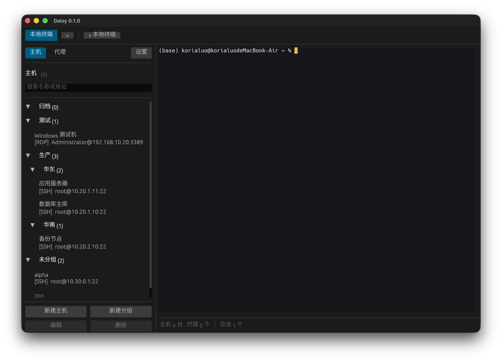
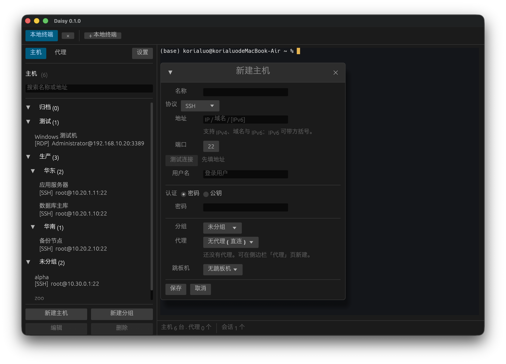

# Daisy

跨平台的远程连接工具：SSH、RDP、代理隧道，单窗口多标签。

界面用 egui 绘制，终端渲染基于 `alacritty_terminal`，本地库用 SQLCipher 加密，
凭据字段再做一层 AES-256-GCM。



新建主机表单：



## 功能现状

| 能力 | 状态 |
| --- | --- |
| 本地终端（PTY + VTE 渲染，`vim` 彩色正常） | ✅ |
| 终端文本选择与复制粘贴（拖选 / 双击选词 / 三击选行、右键菜单复制粘贴、`⌘C` `⌘V`） | ✅ |
| SSH：密码 / RSA 密钥双认证，IP / 域名 / IPv6 | ✅ 已在真实 Linux（CentOS Stream 9 / OpenSSH 9.9）验收 |
| 代理隧道：SOCKS5 / HTTP CONNECT / 跳板机（ProxyJump） | ✅ |
| 主机管理：分组树（两层）、搜索、排序、右键菜单、拖拽重排标签页 | ✅ |
| 主题（深/浅）、界面缩放、终端字号与配色 | ✅ |
| 全局提示浮层、状态栏、日志落盘 | ✅ |
| RDP：连接、认证、画面显示（FreeRDP 3.x FFI + 专用会话线程） | ✅ 已在真实 Windows Server 上验证出图 |
| RDP：键鼠输入注入（键盘扫描码、鼠标按键、滚轮，含坐标反变换） | ✅ 真实 Windows 上验证操作生效 |
| RDP：画面缩放四档（适应窗口 / 铺满 / 原始大小 / 自定义 25%–400%，按主机记忆） | ✅ |
| RDP：Windows 光标（服务端下发位图 → 本地解码绘制，画出后隐藏本机光标） | ✅ |
| RDP：剪贴板（文本与文件，双向；文件走 MS-RDPECLIP 分片传输） | ✅ 已在真实 Windows 上双向验收 |
| RDP：分辨率动态调整（跟随窗口 / 固定档，按主机记忆） | ✅ |
| RDP：内容放大倍数（100%–500%，独立于分辨率，按主机记忆） | ✅ |
| Windows 适配 | 🚧 工具链与构建脚本就绪，待真机出包验收 |

## 构建

前置：

- **Rust 1.99**：`rust-toolchain.toml` 已固定版本，进入目录时 rustup 会自动切换
- **FreeRDP 3.x 静态库**：首次构建前先拉源码、再编库（两个脚本，互不代劳）
- Xcode Command Line Tools（macOS 本地开发）

```bash
scripts/fetch-freerdp.sh    # 首次：拉 FreeRDP 3.32.1 源码到 vendor/freerdp（带 SHA256 校验）
scripts/build-freerdp.sh    # 首次：编静态库到 vendor/dist/freerdp-macos-<arch>，耗时较长
cargo build --release
```

开发环境（工具链版本、target 清单、代理配置）的完整记录见
[docs/DEVENV.md](docs/DEVENV.md)。

## 运行

```bash
cargo run --release          # 或 ./target/release/daisy-app
```

打包成 macOS 应用：

```bash
scripts/build-macos.sh       # → dist/Daisy.app 与 dist/Daisy-<版本>-release.dmg
```

打包脚本会校验二进制没有指向 Homebrew / `/usr/local` 的动态库依赖——
本机装了 Homebrew 时，动态依赖会让程序在干净机器上直接起不来。

### Windows（最低 Windows 10 x64）

前置比 macOS 多几样（MSVC + CMake + vcpkg + Perl + NASM + LLVM），
一页纸列全了：[docs/DEVENV-WINDOWS.md](docs/DEVENV-WINDOWS.md)。

```powershell
pwsh -File scripts\build-freerdp.ps1 -Clean   # 首次：FreeRDP 静态库（vcpkg 提供 OpenSSL/zlib）
pwsh -File scripts\build-windows.ps1          # → dist\Daisy-windows-x64\{daisy.exe} + zip
```

> **Windows 侧尚未在真机验收**：工具链与构建脚本已就绪，目前做到「全工作区
> Windows 目标交叉检查通过 + 构建脚本可跑」，还没有在真实 Windows 机器上出包并运行。
> 装机清单、验证命令与已知坑见 [docs/DEVENV-WINDOWS.md](docs/DEVENV-WINDOWS.md)。

## 质量门禁

```bash
scripts/check.sh             # fmt 检查 + clippy 零警告 + 全量测试 + 交叉编译检查
scripts/check-windows.sh     # 只跑 Windows 目标交叉检查（全工作区，含 clippy 可选）
```

单个环节也可以单独跑：

```bash
cargo clippy --workspace --all-targets -- -D warnings
cargo test --workspace
```

Windows 目标交叉检查不是简单的 `cargo check --target`——带原生 C 代码的依赖
（`ring` / `sqlcipher` / `openssl`）在 macOS 上会先把构建脚本跑挂，我们的代码
根本轮不到编译。`scripts/cc-stub.sh` 用桩编译器 + 假 OpenSSL 目录把这段绕过去：
把「编译第三方 C 依赖」换成「建空产物文件」，只在预处理（`-E`，openssl-sys 认版本要用）
时转交宿主 clang。所以**连 `daisy-app` 一起查**。

## 数据与日志

| 内容 | macOS | Windows |
| --- | --- | --- |
| 加密库 | `~/Library/Application Support/Daisy/daisy.db` | `%APPDATA%\Daisy\daisy.db` |
| 主密钥 | 无（内置密钥） | `%APPDATA%\Daisy\key.bin`（DPAPI 加密） |
| 配置 | `~/Library/Application Support/Daisy/config.toml` | `%APPDATA%\Daisy\config.toml` |
| 日志 | `~/Library/Application Support/Daisy/logs/daisy.<日期>` | `%APPDATA%\Daisy\logs\daisy.<日期>` |

日志按日滚动、保留 7 天；界面「设置 → 日志 → 打开」可直接打开目录。
配置文件**只在改动过配置时才生成**——没改过就用内置默认值。

**两个平台的密钥强度不同**：macOS 用内置密钥（混淆，`strings` 一下就能还原），
Windows 用 DPAPI（真随机的密钥，绑定当前 Windows 用户）。这条差异是
`daisy-core/src/key.rs` 里两个 `KeyProvider` 实现，调用方不用管。

## 开发辅助

| 环境变量 | 用途 |
| --- | --- |
| `DAISY_DATA_DIR` | 覆盖数据目录（库、配置、日志一起走）。灌测试数据、隔离验证用 |
| `DAISY_LOG` | 日志级别，**优先于**配置里的 `log_level` |
| `DAISY_SMOKE_MS` | 指定毫秒后自动关窗；窗口固定到 (80,80) 便于自动化截图 |
| `DAISY_SMOKE_AUTOCONNECT` | 启动后自动连接指定名称的主机（走与双击完全相同的那条路径） |
| `DAISY_SMOKE_RDP_SCALE` | 强制 RDP 会话的初始缩放档（`fit`/`fill`/`actual`/`custom`），用于逐档截图核对 |
| `DAISY_SMOKE_RDP_KEY` | 会话出图后注入输入：`win+r` 发按键、`move:x,y` 把指针移到指定桌面坐标（用于验证光标位置） |
| `DAISY_SMOKE_OPEN` | 启动即打开某个窗口：`settings` / `new-host` / `new-proxy` / `edit-host:<名称>`。用于无人值守核对窗口布局 |
| `DAISY_SEED_PASSWORD` | `seed_host` 示例读口令用（口令不进命令行，避免被 `ps` 看到） |

演示数据与截图辅助：

```bash
DAISY_DATA_DIR=/tmp/daisy-demo cargo run -p daisy-app --example seed_group_demo
DAISY_DATA_DIR=/tmp/daisy-demo DAISY_SMOKE_MS=8000 cargo run
```

图标资源由 `scripts/make-icon.py` 生成（需要 Pillow），产出
`assets/icons/` 下的 PNG / ICNS / 原始 RGBA（后者由主程序 `include_bytes!` 嵌入，
省掉一个 PNG 解码依赖）。

## 已知问题

- **RDP over IPv6 只验证到地址层**：地址解析与 TCP 建立已实测，协议层（握手/画面/输入）
  缺 IPv6 目标机，计划在 Windows 适配阶段补验。
- **本地库密钥内置**：按设计取舍——密钥硬编码在二进制里，属于**混淆而非加密**，
  挡不住对本地文件有读取权限的攻击者。
- **日志级别跟随配置文件时**：改级别即时生效，但若启动时设了 `DAISY_LOG`，
  环境变量在整个进程生命周期内优先。
- **打包未做公证**：`scripts/build-macos.sh` 只做 ad-hoc 签名，本机与内部测试可用；
  对外分发需要 Developer ID 证书与公证流程。

## 项目文档

| 文档 | 内容 |
| --- | --- |
| [docs/DEVENV.md](docs/DEVENV.md) | macOS 开发环境记录（工具链版本、target 清单、代理配置） |
| [docs/DEVENV-WINDOWS.md](docs/DEVENV-WINDOWS.md) | Windows 开发环境（工具清单、VS2019/2022 组件、验证命令、已知坑） |

## 许可证

MIT，见 [LICENSE](LICENSE)。

## 目录结构

```
crates/
  daisy-core/     领域模型、配置、地址解析、日志初始化（不依赖 GUI 与协议）
  daisy-store/    SQLCipher 加密库、schema 迁移、字段级加密
  daisy-net/      SOCKS5 / HTTP CONNECT 拨号器、隧道、端口转发
  daisy-ssh/      russh 会话、认证、跳板机、known_hosts
  daisy-rdp/      FreeRDP FFI 绑定、RAII 封装、目标地址解析
  daisy-term/     PTY、VTE 网格、渲染、配色
  daisy-app/      egui 界面、会话管理、视图
assets/icons/     应用图标（由 scripts/make-icon.py 生成）
scripts/          构建、打包、质量门禁、图标生成
```
